# Lifecycle

!!! Warning
    This page will be populated with more documentation soon.

A job has a `status` which follows a strict workflow. Much of the functionality within CHAOTICA for a job is tied to it's status.

## What happens to phases

Some job transitions cascade to the job's phases:

- **Lost**: every phase that isn't finished yet (anything before *Delivered*, and not already cancelled, postponed, deleted or archived) is moved to **Cancelled**, and its scheduled timeslots are deleted. Delivered phases are left alone. The confirmation modal shows how many phases and slots will be cleared.
- **Deleted**: every phase is moved to **Deleted** and its timeslots are removed. Phases that are already deleted don't block deleting the job.
- **Completed**: happens automatically once all phases are finished, either when the last phase is delivered or via the background workflow task. *Delivered*, *Cancelled*, *Deleted* and *Archived* phases count as finished. A **Postponed** phase does not, so a job with a postponed phase stays *In Progress*. Completing a job by hand applies the same rule: it's refused while any phase is unfinished.

## Reopening a completed job

Completed jobs show a **Reopen Job** button (anyone who can update the job). It
moves the job back to **Scoping** and asks for a **reason**, which is recorded
in the job's Activity log as a workflow status change. Delivered phases are
left as they are; add or update phases, then sign the scope off again as
normal. It deliberately goes to Scoping rather than In Progress: with every
existing phase still finished, the auto-complete task would otherwise close the
job again straight away.

New phases can't be added to (or cloned onto) a job that is Completed, Lost,
Deleted or Archived, or before scoping has started — reopen it first. This
stops new work hiding behind a Completed job, where it wouldn't appear on the
dashboard or in the QA and delivery queues.

As a safety net, if a phase that's in flight (Pending Scheduling up to
Completed) ever ends up on a Completed job, saving it moves the job back to
**In Progress** and logs why. Old never-started **Draft** phases on completed
jobs are ignored.

Reopening a phase (see [Phase lifecycle](phases/lifecycle.md#reopening-a-phase))
also reopens its job to In Progress if the job was Completed.

Once a job is **Lost**, **Deleted** or **Archived**, its phases can't move forward through the workflow, can't take new scheduler bookings, and are ignored by the automatic workflow and late-notification tasks. A **Completed** job's schedule is locked too — see [Booking & Validation](../scheduling/validation.md).

The raw state diagram is below and shows the allowed transitions between states.

```dot
digraph {
        subgraph cluster_jobtracker_Job_status {
                graph [label="jobtracker.Job.status"]
                "jobtracker.Job.status.10" [label=Deleted shape=doublecircle]
                "jobtracker.Job.status.3" [label="Additional Scoping Required" shape=circle]
                "jobtracker.Job.status.1" [label="Pending Scoping" shape=circle]
                "jobtracker.Job.status.5" [label="Scoping Complete" shape=circle]
                "jobtracker.Job.status.9" [label=Lost shape=circle]
                "jobtracker.Job.status.2" [label=Scoping shape=circle]
                "jobtracker.Job.status.0" [label=Draft shape=circle]
                "jobtracker.Job.status.7" [label="In Progress" shape=circle]
                "jobtracker.Job.status.8" [label=Completed shape=circle]
                "jobtracker.Job.status.6" [label="Pending Start" shape=circle]
                "jobtracker.Job.status.4" [label="Pending Scope Signoff" shape=circle]
                "jobtracker.Job.status.11" [label=Archived shape=circle]
                "jobtracker.Job.status.11" -> "jobtracker.Job.status.10" [label=to_delete]
                "jobtracker.Job.status.3" -> "jobtracker.Job.status.4" [label=to_scope_pending_signoff]
                "jobtracker.Job.status.2" -> "jobtracker.Job.status.3" [label=to_additional_scope_req]
                "jobtracker.Job.status.9" -> "jobtracker.Job.status.10" [label=to_delete]
                "jobtracker.Job.status.0" -> "jobtracker.Job.status.1" [label=to_pending_scope]
                "jobtracker.Job.status.0" -> "jobtracker.Job.status.9" [label=to_lost]
                "jobtracker.Job.status.3" -> "jobtracker.Job.status.9" [label=to_lost]
                "jobtracker.Job.status.4" -> "jobtracker.Job.status.10" [label=to_delete]
                "jobtracker.Job.status.0" -> "jobtracker.Job.status.10" [label=to_delete]
                "jobtracker.Job.status.3" -> "jobtracker.Job.status.10" [label=to_delete]
                "jobtracker.Job.status.8" -> "jobtracker.Job.status.10" [label=to_delete]
                "jobtracker.Job.status.9" -> "jobtracker.Job.status.11" [label=to_archive]
                "jobtracker.Job.status.1" -> "jobtracker.Job.status.9" [label=to_lost]
                "jobtracker.Job.status.5" -> "jobtracker.Job.status.9" [label=to_lost]
                "jobtracker.Job.status.6" -> "jobtracker.Job.status.10" [label=to_delete]
                "jobtracker.Job.status.1" -> "jobtracker.Job.status.10" [label=to_delete]
                "jobtracker.Job.status.7" -> "jobtracker.Job.status.10" [label=to_delete]
                "jobtracker.Job.status.8" -> "jobtracker.Job.status.11" [label=to_archive]
                "jobtracker.Job.status.8" -> "jobtracker.Job.status.2" [label=to_reopen]
                "jobtracker.Job.status.8" -> "jobtracker.Job.status.7" [label=to_reopen_for_phase]
                "jobtracker.Job.status.6" -> "jobtracker.Job.status.9" [label=to_lost]
                "jobtracker.Job.status.7" -> "jobtracker.Job.status.8" [label=to_complete]
                "jobtracker.Job.status.5" -> "jobtracker.Job.status.10" [label=to_delete]
                "jobtracker.Job.status.2" -> "jobtracker.Job.status.4" [label=to_scope_pending_signoff]
                "jobtracker.Job.status.2" -> "jobtracker.Job.status.9" [label=to_lost]
                "jobtracker.Job.status.4" -> "jobtracker.Job.status.5" [label=to_scope_complete]
                "jobtracker.Job.status.1" -> "jobtracker.Job.status.2" [label=to_scoping]
                "jobtracker.Job.status.5" -> "jobtracker.Job.status.2" [label=to_scoping]
                "jobtracker.Job.status.6" -> "jobtracker.Job.status.7" [label=to_in_progress]
                "jobtracker.Job.status.5" -> "jobtracker.Job.status.7" [label=to_in_progress]
                "jobtracker.Job.status.5" -> "jobtracker.Job.status.6" [label=to_pending_start]
                "jobtracker.Job.status.2" -> "jobtracker.Job.status.10" [label=to_delete]
        }
}
```

