# Lifecycle

!!! Warning
    This page will be populated with more documentation soon.

Like a job, a Phase also has a `status` which follows a strict workflow. Even more of the functionality within CHAOTICA for a phase is tied to it's status and will also affect a Job's status.

## Closed phases

**Cancelled**, **Postponed**, **Deleted** and **Archived** are closed statuses:

- Cancelling, postponing or deleting a phase deletes its scheduled timeslots.
- A closed phase can't be cancelled or postponed again. In particular, a cancelled, deleted or archived phase can no longer be "revived" by postponing it and then moving it back to *Pending Scheduling*. Only a **Postponed** phase can return to *Pending Scheduling*.
- Closed phases can't take new scheduler bookings, and slots can't be moved onto them (see [Booking & Validation](../../scheduling/validation.md)).
- Only phases from **Pending Scheduling** to the end of QA can be scheduled at all — Draft, Completed and Delivered phases are locked in the scheduler too.

## Reopening a phase

**Completed** and **Delivered** phases show a **Reopen Phase** button (anyone
who can update the job). It moves the phase back to **In Progress** — e.g. for
late report fixes — and asks for a **reason**, recorded in the phase's Activity
log as a workflow status change. If the job was **Completed**, it goes back to
**In Progress** too (logged on the job, naming the phase), so the phase shows
up on the dashboard and in the QA/delivery queues again. Once the phase is
delivered again, the job completes automatically as usual.

Phases on Lost, Deleted or Archived jobs can't be reopened.

## The job's status matters too

Forward transitions (*Pending Scheduling* through *Delivered*) are only allowed while the job is open. If the job is **Lost**, **Deleted** or **Archived**, its phases can't progress. If an in-flight phase on a **Completed** job is moved on, the job goes back to **In Progress** so the work isn't hidden (see [Reopening a completed job](../lifecycle.md#reopening-a-completed-job)).

## Scheduling and status

- Booking the first slot on a *Pending Scheduling* phase moves it to *Schedule Tentative*.
- Removing a phase's last slot moves a *Schedule Tentative*/*Confirmed* phase back to *Pending Scheduling*. This applies however the slot goes: deleted, cleared from the scheduler (including job/phase-scoped clears) or moved to another phase.
- The stored start/QA/delivery dates are recalculated from the schedule nightly, and cleared once a phase has no slots left.

The raw state diagram is below and shows the allowed transitions between states. (Yes, I know it's mental to read)

```dot
digraph {
        subgraph cluster_jobtracker_Phase_status {
                graph [label="jobtracker.Phase.status"]
                "jobtracker.Phase.status.6" [label="Ready to Begin" shape=circle]
                "jobtracker.Phase.status.4" [label="Pre-checks" shape=circle]
                "jobtracker.Phase.status.16" [label=Cancelled shape=circle]
                "jobtracker.Phase.status.10" [label="Author Tech Updates" shape=circle]
                "jobtracker.Phase.status.12" [label="Pres QA" shape=circle]
                "jobtracker.Phase.status.11" [label="Pending Presentation QA" shape=circle]
                "jobtracker.Phase.status.13" [label="Author Pres Updates" shape=circle]
                "jobtracker.Phase.status.9" [label="Tech QA" shape=circle]
                "jobtracker.Phase.status.1" [label="Pending Scheduling" shape=circle]
                "jobtracker.Phase.status.3" [label="Schedule Confirmed" shape=circle]
                "jobtracker.Phase.status.17" [label=Postponed shape=circle]
                "jobtracker.Phase.status.8" [label="Pending Technical QA" shape=circle]
                "jobtracker.Phase.status.2" [label="Schedule Tentative" shape=circle]
                "jobtracker.Phase.status.0" [label=Draft shape=circle]
                "jobtracker.Phase.status.15" [label=Delivered shape=circle]
                "jobtracker.Phase.status.19" [label=Archived shape=circle]
                "jobtracker.Phase.status.5" [label="Client Not Ready" shape=circle]
                "jobtracker.Phase.status.14" [label=Completed shape=circle]
                "jobtracker.Phase.status.7" [label="In Progress" shape=circle]
                "jobtracker.Phase.status.18" [label=Deleted shape=circle]
                "jobtracker.Phase.status.11" -> "jobtracker.Phase.status.17" [label=to_postponed]
                "jobtracker.Phase.status.14" -> "jobtracker.Phase.status.15" [label=to_delivered]
                "jobtracker.Phase.status.18" -> "jobtracker.Phase.status.19" [label=to_archived]
                "jobtracker.Phase.status.7" -> "jobtracker.Phase.status.16" [label=to_cancelled]
                "jobtracker.Phase.status.2" -> "jobtracker.Phase.status.17" [label=to_postponed]
                "jobtracker.Phase.status.3" -> "jobtracker.Phase.status.16" [label=to_cancelled]
                "jobtracker.Phase.status.12" -> "jobtracker.Phase.status.17" [label=to_postponed]
                "jobtracker.Phase.status.11" -> "jobtracker.Phase.status.12" [label=to_pres_qa]
                "jobtracker.Phase.status.12" -> "jobtracker.Phase.status.14" [label=to_completed]
                "jobtracker.Phase.status.14" -> "jobtracker.Phase.status.18" [label=to_deleted]
                "jobtracker.Phase.status.17" -> "jobtracker.Phase.status.1" [label=to_pending_sched]
                "jobtracker.Phase.status.8" -> "jobtracker.Phase.status.16" [label=to_cancelled]
                "jobtracker.Phase.status.15" -> "jobtracker.Phase.status.18" [label=to_deleted]
                "jobtracker.Phase.status.9" -> "jobtracker.Phase.status.16" [label=to_cancelled]
                "jobtracker.Phase.status.6" -> "jobtracker.Phase.status.16" [label=to_cancelled]
                "jobtracker.Phase.status.15" -> "jobtracker.Phase.status.17" [label=to_postponed]
                "jobtracker.Phase.status.2" -> "jobtracker.Phase.status.16" [label=to_cancelled]
                "jobtracker.Phase.status.16" -> "jobtracker.Phase.status.18" [label=to_deleted]
                "jobtracker.Phase.status.1" -> "jobtracker.Phase.status.17" [label=to_postponed]
                "jobtracker.Phase.status.0" -> "jobtracker.Phase.status.16" [label=to_cancelled]
                "jobtracker.Phase.status.8" -> "jobtracker.Phase.status.9" [label=to_tech_qa]
                "jobtracker.Phase.status.3" -> "jobtracker.Phase.status.18" [label=to_deleted]
                "jobtracker.Phase.status.4" -> "jobtracker.Phase.status.6" [label=to_ready]
                "jobtracker.Phase.status.17" -> "jobtracker.Phase.status.18" [label=to_deleted]
                "jobtracker.Phase.status.3" -> "jobtracker.Phase.status.17" [label=to_postponed]
                "jobtracker.Phase.status.9" -> "jobtracker.Phase.status.10" [label=to_tech_qa_updates]
                "jobtracker.Phase.status.2" -> "jobtracker.Phase.status.3" [label=to_sched_confirmed]
                "jobtracker.Phase.status.15" -> "jobtracker.Phase.status.19" [label=to_archived]
                "jobtracker.Phase.status.4" -> "jobtracker.Phase.status.16" [label=to_cancelled]
                "jobtracker.Phase.status.16" -> "jobtracker.Phase.status.19" [label=to_archived]
                "jobtracker.Phase.status.5" -> "jobtracker.Phase.status.18" [label=to_deleted]
                "jobtracker.Phase.status.14" -> "jobtracker.Phase.status.17" [label=to_postponed]
                "jobtracker.Phase.status.13" -> "jobtracker.Phase.status.16" [label=to_cancelled]
                "jobtracker.Phase.status.10" -> "jobtracker.Phase.status.8" [label=to_pending_tech_qa]
                "jobtracker.Phase.status.12" -> "jobtracker.Phase.status.13" [label=to_pres_qa_updates]
                "jobtracker.Phase.status.10" -> "jobtracker.Phase.status.16" [label=to_cancelled]
                "jobtracker.Phase.status.6" -> "jobtracker.Phase.status.17" [label=to_postponed]
                "jobtracker.Phase.status.6" -> "jobtracker.Phase.status.18" [label=to_deleted]
                "jobtracker.Phase.status.7" -> "jobtracker.Phase.status.18" [label=to_deleted]
                "jobtracker.Phase.status.7" -> "jobtracker.Phase.status.14" [label=to_completed]
                "jobtracker.Phase.status.7" -> "jobtracker.Phase.status.17" [label=to_postponed]
                "jobtracker.Phase.status.5" -> "jobtracker.Phase.status.6" [label=to_ready]
                "jobtracker.Phase.status.0" -> "jobtracker.Phase.status.1" [label=to_pending_sched]
                "jobtracker.Phase.status.2" -> "jobtracker.Phase.status.1" [label=to_pending_sched]
                "jobtracker.Phase.status.4" -> "jobtracker.Phase.status.18" [label=to_deleted]
                "jobtracker.Phase.status.5" -> "jobtracker.Phase.status.16" [label=to_cancelled]
                "jobtracker.Phase.status.13" -> "jobtracker.Phase.status.17" [label=to_postponed]
                "jobtracker.Phase.status.4" -> "jobtracker.Phase.status.5" [label=to_not_ready]
                "jobtracker.Phase.status.1" -> "jobtracker.Phase.status.16" [label=to_cancelled]
                "jobtracker.Phase.status.13" -> "jobtracker.Phase.status.18" [label=to_deleted]
                "jobtracker.Phase.status.15" -> "jobtracker.Phase.status.16" [label=to_cancelled]
                "jobtracker.Phase.status.1" -> "jobtracker.Phase.status.2" [label=to_sched_tentative]
                "jobtracker.Phase.status.9" -> "jobtracker.Phase.status.18" [label=to_deleted]
                "jobtracker.Phase.status.8" -> "jobtracker.Phase.status.18" [label=to_deleted]
                "jobtracker.Phase.status.10" -> "jobtracker.Phase.status.17" [label=to_postponed]
                "jobtracker.Phase.status.11" -> "jobtracker.Phase.status.16" [label=to_cancelled]
                "jobtracker.Phase.status.11" -> "jobtracker.Phase.status.18" [label=to_deleted]
                "jobtracker.Phase.status.9" -> "jobtracker.Phase.status.17" [label=to_postponed]
                "jobtracker.Phase.status.1" -> "jobtracker.Phase.status.3" [label=to_sched_confirmed]
                "jobtracker.Phase.status.13" -> "jobtracker.Phase.status.11" [label=to_pending_pres_qa]
                "jobtracker.Phase.status.10" -> "jobtracker.Phase.status.18" [label=to_deleted]
                "jobtracker.Phase.status.3" -> "jobtracker.Phase.status.4" [label=to_pre_checks]
                "jobtracker.Phase.status.0" -> "jobtracker.Phase.status.18" [label=to_deleted]
                "jobtracker.Phase.status.2" -> "jobtracker.Phase.status.18" [label=to_deleted]
                "jobtracker.Phase.status.12" -> "jobtracker.Phase.status.16" [label=to_cancelled]
                "jobtracker.Phase.status.9" -> "jobtracker.Phase.status.11" [label=to_pending_pres_qa]
                "jobtracker.Phase.status.3" -> "jobtracker.Phase.status.2" [label=to_sched_tentative]
                "jobtracker.Phase.status.12" -> "jobtracker.Phase.status.18" [label=to_deleted]
                "jobtracker.Phase.status.0" -> "jobtracker.Phase.status.17" [label=to_postponed]
                "jobtracker.Phase.status.14" -> "jobtracker.Phase.status.16" [label=to_cancelled]
                "jobtracker.Phase.status.6" -> "jobtracker.Phase.status.7" [label=to_in_progress]
                "jobtracker.Phase.status.14" -> "jobtracker.Phase.status.7" [label=to_reopen]
                "jobtracker.Phase.status.15" -> "jobtracker.Phase.status.7" [label=to_reopen]
                "jobtracker.Phase.status.3" -> "jobtracker.Phase.status.1" [label=to_pending_sched]
                "jobtracker.Phase.status.4" -> "jobtracker.Phase.status.17" [label=to_postponed]
                "jobtracker.Phase.status.5" -> "jobtracker.Phase.status.17" [label=to_postponed]
                "jobtracker.Phase.status.19" -> "jobtracker.Phase.status.18" [label=to_deleted]
                "jobtracker.Phase.status.7" -> "jobtracker.Phase.status.8" [label=to_pending_tech_qa]
                "jobtracker.Phase.status.1" -> "jobtracker.Phase.status.18" [label=to_deleted]
                "jobtracker.Phase.status.8" -> "jobtracker.Phase.status.17" [label=to_postponed]
        }
}
```

